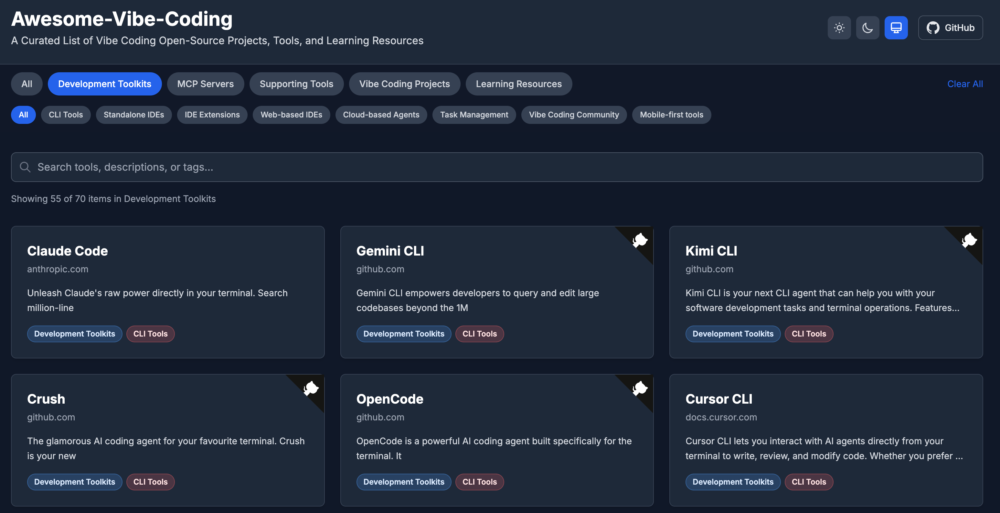
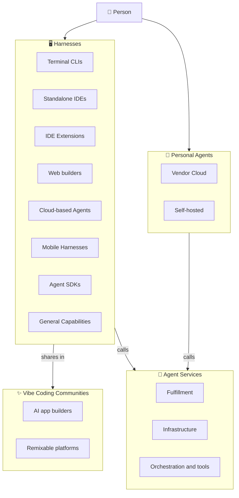

# Awesome-Agent-Ecosystem

[](https://0xwelt.github.io/Awesome-Agent-Ecosystem/)
[](https://github.com/0xWelt/Awesome-Agent-Ecosystem)
[](https://github.com/0xWelt/Awesome-Agent-Ecosystem/fork)
[](https://creativecommons.org/licenses/by/4.0/)
[](https://awesome.re)

A curated list of coding harnesses, vibe-coding communities, named personal agents, and the tools and services agents call.

This repository is Awesome-Agent-Ecosystem.

🌐 **Live Website**: [https://0xwelt.github.io/Awesome-Agent-Ecosystem/](https://0xwelt.github.io/Awesome-Agent-Ecosystem/)



> **Content structure**: entries are organized in the [`contents/`](contents/) directory — one
> markdown file per entry, grouped by section, category, and subcategory, with `_meta.md`
> files describing each folder. The live website is generated from these files
> by `yaal/scripts/parse-readme.js`.

One list, four sections. Coding harnesses and Lovable-style web builders stay in [Harnesses](contents/harnesses/). Vibe coding communities stay in [Vibe Coding Communities](contents/vibe-coding-community/). Named personal agents stay in [Personal Agents](contents/personal-agents/). Supporting tools and services, including infrastructure platforms and their official CLIs, stay in [Agent Services](contents/agent-services/). Each product is listed in one section.

## Architecture

Coding harnesses run the agent, including Lovable-style builders that create apps in the browser. Vibe coding communities are where people create apps with AI and share them. Personal agents are named products that act for a person over time, on a vendor cloud computer or on a machine you run. Agent services are the tools and platforms those agents call.



## Categories

| Category | Description | Location |
| --- | --- | --- |
| Harnesses | Tools that run AI coding agents — terminal CLIs, standalone IDEs, IDE extensions, Lovable-style web builders (Bolt.new, Replit, Open Lovable, Firebase Studio), cloud coding agents, mobile apps, SDKs, and their general capabilities (plan, goal, compact, PTC, hooks, standards and protocols). | [contents/harnesses/](contents/harnesses/) |
| Vibe Coding Communities | Create apps with AI and share them with the community — AI app builders and remixable creation platforms. | [contents/vibe-coding-community/](contents/vibe-coding-community/) |
| Personal Agents | Named personal agents that act over time, grouped by who provides the persistent runtime: a vendor cloud computer, or a machine and gateway you run yourself. | [contents/personal-agents/](contents/personal-agents/) |
| Agent Services | Supporting tools and services an agent can call, including fulfillment, infrastructure and code hosts with their official CLIs, and code-related tools such as observability, context, and skill directories. | [contents/agent-services/](contents/agent-services/) |

### Personal Agents

| Category | Description | Location |
| --- | --- | --- |
| Vendor Cloud | Named personal-agent products whose persistent runtime is provided by the vendor. This includes desktop apps and separately named products. | [contents/personal-agents/vendor-cloud/](contents/personal-agents/vendor-cloud/) |
| Self-hosted | Named personal agents you run yourself on a machine or gateway you control. | [contents/personal-agents/self-hosted/](contents/personal-agents/self-hosted/) |

A general chat assistant is not an entry, even when it has tools, connectors, computer use, or a cowork mode. ChatGPT, Claude, Gemini, and Microsoft Copilot are not listed in place of that company's named agent.

### Agent Services

| Category | Description | Location |
| --- | --- | --- |
| Agent Orchestration | Workflow and automation platforms that connect work across tools. | [contents/agent-services/agent-orchestration/](contents/agent-services/agent-orchestration/) |
| Careers | Job search, matching, and applications an agent can run for a person. | [contents/agent-services/careers/](contents/agent-services/careers/) |
| Customer Support | Help desks and support inboxes an agent can search and update. | [contents/agent-services/customer-support/](contents/agent-services/customer-support/) |
| Data Analytics | Product analytics, experimentation, warehousing, and data platforms. | [contents/agent-services/data-analytics/](contents/agent-services/data-analytics/) |
| Design | Design, media, and visual creation tools an agent can operate. | [contents/agent-services/design/](contents/agent-services/design/) |
| Documents and Files | Documents, drives, and file stores an agent can search, read, or edit. | [contents/agent-services/documents-and-files/](contents/agent-services/documents-and-files/) |
| Finance and Legal | Accounting, payroll, agreements, market data, and compliance systems. | [contents/agent-services/finance-and-legal/](contents/agent-services/finance-and-legal/) |
| Inbox and Collaboration | Email, chat, newsletters, and team messaging an agent can read or send. | [contents/agent-services/inbox-and-collaboration/](contents/agent-services/inbox-and-collaboration/) |
| Infrastructure | Cloud, hosting, code hosts, containers, databases, security, and the other platforms an agent can operate. | [contents/agent-services/infrastructure/](contents/agent-services/infrastructure/) |
| Logistics | Freight booking, rates, and shipment tracking an agent can look up or act on. | [contents/agent-services/logistics/](contents/agent-services/logistics/) |
| Marketing | Campaigns, audiences, referrals, and social publishing. | [contents/agent-services/marketing/](contents/agent-services/marketing/) |
| Payments | Payments, banking, billing, trading, and checkout an agent can query or act on. | [contents/agent-services/payments/](contents/agent-services/payments/) |
| Productivity | Tasks, notes, knowledge bases, and workspaces an agent uses to get work done. | [contents/agent-services/productivity/](contents/agent-services/productivity/) |
| Research | Search, SEO, web data, and company research services. | [contents/agent-services/research/](contents/agent-services/research/) |
| Sales | CRM, prospecting, enrichment, and outreach services. | [contents/agent-services/sales/](contents/agent-services/sales/) |
| Scheduling | Calendars, meetings, and reservations an agent can search, book, or update. | [contents/agent-services/scheduling/](contents/agent-services/scheduling/) |
| Shopping | Stores and delivery services an agent can use to find goods, run a shop, or place an order. | [contents/agent-services/shopping/](contents/agent-services/shopping/) |

Entries are the tool or service. Connection methods are tags, not categories. The tag vocabulary is `mcp` (official or vendor-hosted MCP server), `skill` (an Agent Skill the vendor ships), `grok-bot` (listed in the Grok Bot Connect Apps catalog), `cli` (official command-line interface), and `chatgpt` (official ChatGPT app or Actions published by the vendor). Add a tag only when that surface is real.

## Adding an entry

Create a markdown file in the matching `contents/` folder:

```markdown
---
name: Tool Name
link: https://example.com
---

Short description of the entry.
```

Required frontmatter is `name` and `link`. Leave out a `command` field. Use the canonical product URL, without UTM, referral, or affiliate parameters. An optional `image` must be an absolute `https` URL of the product's official preview. Do not invent one.

Put a coding harness or Lovable-style web builder in [Harnesses](contents/harnesses/). Put a vibe coding community in [Vibe Coding Communities](contents/vibe-coding-community/). Put a named personal agent in [Personal Agents](contents/personal-agents/): vendor cloud under `vendor-cloud/`, self-hosted under `self-hosted/`. Put a supporting tool or service in [Agent Services](contents/agent-services/). The same product must not appear in more than one section.

The entry is picked up when the website builds. Prefer adding a separate file over editing an existing one — it keeps PRs small and conflict-free.

## Repo Status


## Contributors

This project exists thanks to all the people who contribute.

<a href="https://github.com/0xWelt/Awesome-Agent-Ecosystem/graphs/contributors">
  
</a>

## Star History

[](https://star-history.com/#0xWelt/Awesome-Agent-Ecosystem&Date)

## License

[](https://creativecommons.org/licenses/by/4.0/)

This work is licensed under a
[Creative Commons Attribution 4.0 International License](http://creativecommons.org/licenses/by/4.0/).
