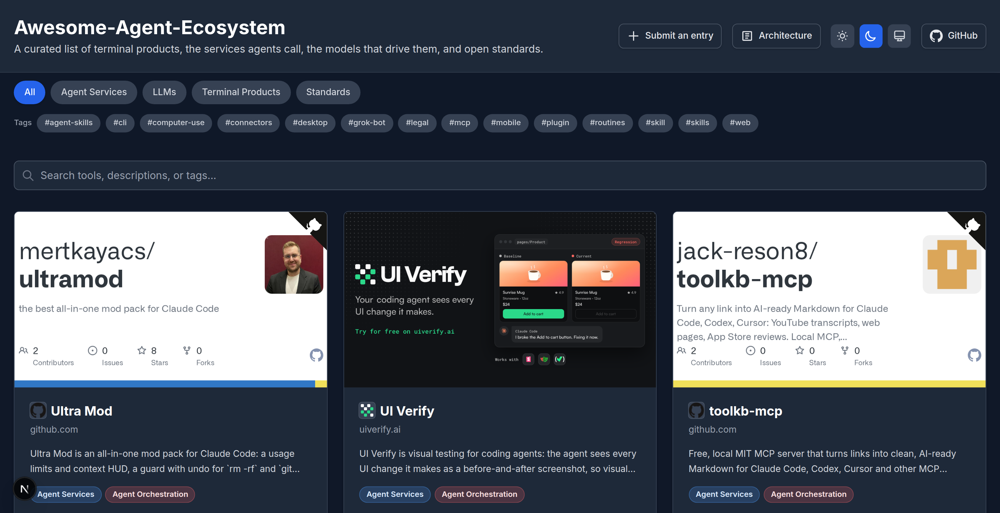
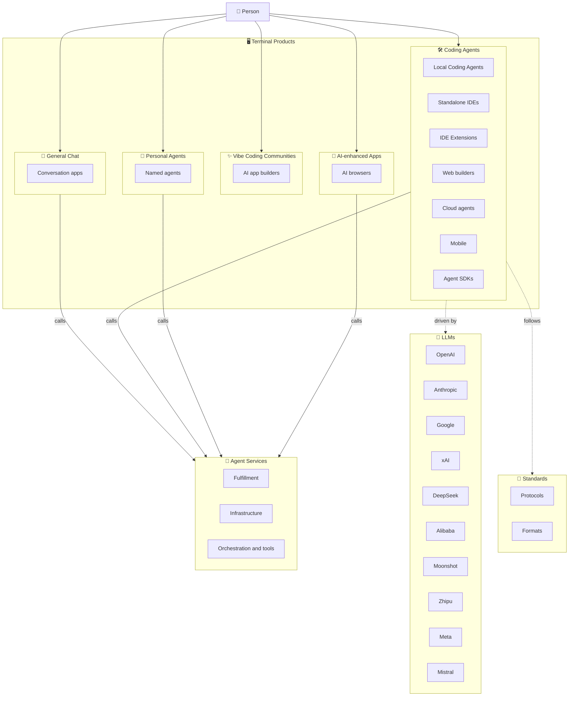

# Awesome-Agent-Ecosystem

[](https://0xwelt.github.io/Awesome-Agent-Ecosystem/)
[](https://github.com/0xWelt/Awesome-Agent-Ecosystem)
[](https://github.com/0xWelt/Awesome-Agent-Ecosystem/fork)
[](https://creativecommons.org/licenses/by/4.0/)
[](https://awesome.re)

A curated list of terminal products, the services agents call, the models that drive them, and open standards.

This repository is Awesome-Agent-Ecosystem.

🌐 **Live Website**: [https://0xwelt.github.io/Awesome-Agent-Ecosystem/](https://0xwelt.github.io/Awesome-Agent-Ecosystem/)



> **Content structure**: entries are organized in the [`contents/`](contents/) directory — one
> markdown file per entry, grouped by section, category, and subcategory, with `_meta.md`
> files describing each folder. The live website is generated from these files
> by `yaal/scripts/parse-readme.js`.

One list with three super-classes, plus thin [Standards](contents/standards/). [Terminal Products](contents/products/) are what a person opens: [General Chat](contents/products/general-chat/), [Coding Agents](contents/products/coding-agents/), [Vibe Coding Communities](contents/products/vibe-coding-community/), [Personal Agents](contents/products/personal-agents/), and [AI-enhanced Apps](contents/products/ai-enhanced-apps/). [Agent Services](contents/agent-services/) are the tools and platforms those products call, including infrastructure and official CLIs. [LLMs](contents/llms/) are the models that drive agents, grouped by the company that trains them. Open protocols and formats stay in Standards. Each product is listed in one file, except a unified chat-and-agent desktop, which is also listed under Personal Agents.

## Architecture

Terminal Products are the five sections a person opens. General Chat is the conversation app itself. Coding agents run the agent, including Lovable-style builders that create apps in the browser. They commonly offer plan mode, goals, compact, hooks, subagents, dynamic workflows, and programmatic tool calling (PTC); those are capabilities, not entries. Vibe coding communities are where people create apps with AI and share them. Personal agents are named products that act for a person over time. They are filed flat under Personal Agents, and runtime and capability forms are category-scoped tags. AI-enhanced apps are traditional products whose main form is still that category, with the interaction rebuilt around AI. Agent services are the tools and platforms those products call. LLMs are the models behind them, not the chat apps and not inference hosts. Standards are open protocols and formats.

Cowork, coding, and computer-use are capabilities, not top-level classes. General Chat always keeps the conversation product, including ChatGPT, Claude, Gemini, Kimi, and Doubao. If the vendor has officially merged chat and agent or work into one desktop app, also list that unified desktop under Personal Agents. ChatGPT Desktop, Claude Desktop, and Gemini for desktop are that case. If the vendor still splits a general-chat line from a separately named agent or work line, such as Kimi versus Kimi Work or Doubao versus Doubao Work, Personal Agents keeps only the named agent or work product. Do not add that vendor's chat-client installer as a second file. Extra named always-on agents, such as Dots and Claude Duet, stay their own files in the same folder. Record how you reach the agent and where the work runs with that section's tags. Coding-primary products stay in Coding Agents. Local coding agents record official interface surfaces with that subclass's tags.

General Chat does not include Claude Code, Gemini CLI, GitHub Copilot, Doubao Work, QwenWork, Kimi Work, or Nano Work. An AI-enhanced app is an independent terminal. A suite that only added an AI button is not an entry there. Do not file the same product twice, except the unified desktop case above.



## Categories

| Category | Description | Location |
| --- | --- | --- |
| Terminal Products | The products a person opens: general chat, coding agents, vibe-coding communities, personal agents, and AI-enhanced apps. | [contents/products/](contents/products/) |
| General Chat | User-facing conversation apps. The chat product itself, not a coding harness and not a named personal agent that acts over time. | [contents/products/general-chat/](contents/products/general-chat/) |
| Coding Agents | Coding-primary products that run AI coding agents — local coding agents, standalone IDEs, IDE extensions, Lovable-style web builders (Bolt.new, Replit, Open Lovable, Firebase Studio), cloud coding agents, mobile apps, and agent SDKs. Coding, cowork, and computer-use remain capabilities, not separate classes. Agent SDKs stay as a subclass here. | [contents/products/coding-agents/](contents/products/coding-agents/) |
| Vibe Coding Communities | Create apps with AI and share them with the community — AI app builders and remixable creation platforms. | [contents/products/vibe-coding-community/](contents/products/vibe-coding-community/) |
| Personal Agents | Named personal agents that act over time, filed flat in this folder. Runtime and capability forms are category-scoped tags, not exclusive subfolders. | [contents/products/personal-agents/](contents/products/personal-agents/) |
| AI-enhanced Apps | Traditional product categories whose main form is still that category, but the interaction has been rebuilt around AI. Independent terminals only. The first entries are AI browsers. | [contents/products/ai-enhanced-apps/](contents/products/ai-enhanced-apps/) |
| Agent Services | Supporting tools and services an agent can call, including fulfillment, infrastructure and code hosts with their official CLIs, and code-related tools such as observability, context, and skill directories. | [contents/agent-services/](contents/agent-services/) |
| LLMs | Models that drive agents, grouped by the company that trains them. Not chat apps, and not inference infrastructure. | [contents/llms/](contents/llms/) |
| Standards | Open protocols and formats in the agent ecosystem, not vendor products and not harness features. | [contents/standards/](contents/standards/) |

### Personal Agents

Named personal agents that act over time live directly in [contents/products/personal-agents/](contents/products/personal-agents/). Runtime and capability forms are category-scoped tags on the entry, not exclusive subfolders.

Interaction surfaces are `desktop` (official desktop or on-device app), `web` (official web app), and `mobile` (official mobile app). `remote` means a phone or a chat channel can dispatch or control work on a connected computer. Execution locus is `local` (the work runs on a computer the user provides, so scheduled or overnight work typically needs that machine awake), `cloud` (the work runs on vendor infrastructure and can continue after a local client is closed), or `self-hosted` (the user runs the agent runtime or gateway). Capabilities the entry already supports stay as `computer-use`, `skills`, `routines`, and `connectors`. These tags combine freely. `skills` on a personal agent means the product supports agent skills, which is separate from the Agent Services connection tag `skill`. Do not add industry or vertical tags.

General Chat always keeps the conversation product, including ChatGPT, Claude, Gemini, Kimi, Doubao, and the other chats in [General Chat](contents/products/general-chat/). That set is not a closed list. If the vendor has officially merged chat and agent or work into one desktop app, that unified desktop is also listed here. ChatGPT Desktop, Claude Desktop, and Gemini for desktop are that case. If the vendor still splits a general-chat line from a separately named agent or work line, such as Kimi versus Kimi Work or Doubao versus Doubao Work, this folder keeps only the named agent or work product. Do not add that vendor's chat-client installer as a second file. Extra named always-on agents, such as Dots and Claude Duet, stay their own files in the same folder.

### Local Coding Agents

Local or self-hosted coding agents live in [contents/products/coding-agents/local-coding-agents/](contents/products/coding-agents/local-coding-agents/). They typically include a terminal, and may also have a web UI or desktop app. Official interface surfaces are category-scoped tags on that entry, and they combine freely.

`cli` is an official terminal, TUI, or CLI. `web` is an official web UI, whether it is served locally or hosted. `desktop` is an official standalone desktop app. `ide` is an official IDE extension or first-party IDE companion, including an official ACP or IDE integration. Unofficial third-party plugins are not `ide`. `mobile` is an official mobile app, including a public TestFlight when it is official. Do not add tags outside that set. One product line stays one file. Do not copy it into IDE Extensions or Mobile Harnesses because it also has those surfaces. Standalone IDEs, IDE Extensions, web builders, cloud agents, mobile harnesses, and agent SDKs stay sibling folders and do not use `tags`.

### Agent Services

| Category | Description | Location |
| --- | --- | --- |
| Agent Orchestration | Workflow and automation platforms that connect work across tools. | [contents/agent-services/agent-orchestration/](contents/agent-services/agent-orchestration/) |
| Careers | Job search, matching, and applications an agent can run for a person. | [contents/agent-services/careers/](contents/agent-services/careers/) |
| Customer Support | Help desks and support inboxes an agent can search and update. | [contents/agent-services/customer-support/](contents/agent-services/customer-support/) |
| Data Analytics | Product analytics, experimentation, warehousing, and data platforms. | [contents/agent-services/data-analytics/](contents/agent-services/data-analytics/) |
| Design | Design, media, and visual creation tools an agent can operate. | [contents/agent-services/design/](contents/agent-services/design/) |
| Documents and Files | Documents, drives, and file stores an agent can search, read, or edit. | [contents/agent-services/documents-and-files/](contents/agent-services/documents-and-files/) |
| Finance and Legal | Accounting, payroll, agreements, market data, and compliance systems. | [contents/agent-services/finance-and-legal/](contents/agent-services/finance-and-legal/) |
| Inbox and Collaboration | Email, chat, newsletters, and team messaging an agent can read or send. | [contents/agent-services/inbox-and-collaboration/](contents/agent-services/inbox-and-collaboration/) |
| Infrastructure | Cloud, hosting, code hosts, containers, databases, security, and the other platforms an agent can operate. | [contents/agent-services/infrastructure/](contents/agent-services/infrastructure/) |
| Logistics | Freight booking, rates, and shipment tracking an agent can look up or act on. | [contents/agent-services/logistics/](contents/agent-services/logistics/) |
| Marketing | Campaigns, audiences, referrals, and social publishing. | [contents/agent-services/marketing/](contents/agent-services/marketing/) |
| Payments | Payments, banking, billing, trading, and checkout an agent can query or act on. | [contents/agent-services/payments/](contents/agent-services/payments/) |
| Productivity | Tasks, notes, knowledge bases, and workspaces an agent uses to get work done. | [contents/agent-services/productivity/](contents/agent-services/productivity/) |
| Research | Search, SEO, web data, and company research services. | [contents/agent-services/research/](contents/agent-services/research/) |
| Sales | CRM, prospecting, enrichment, and outreach services. | [contents/agent-services/sales/](contents/agent-services/sales/) |
| Scheduling | Calendars, meetings, and reservations an agent can search, book, or update. | [contents/agent-services/scheduling/](contents/agent-services/scheduling/) |
| Shopping | Stores and delivery services an agent can use to find goods, run a shop, or place an order. | [contents/agent-services/shopping/](contents/agent-services/shopping/) |

Entries are the tool or service. Connection methods are tags, not categories. The tag vocabulary is `mcp` (official or vendor-hosted MCP server), `skill` (an Agent Skill the vendor ships), `grok-bot` (listed in the Grok Bot Connect Apps catalog), `cli` (official command-line interface), and `chatgpt` (official ChatGPT app or Actions published by the vendor). Add a tag only when that surface is real. Keep the word `skill` here.

Tags are not a global vocabulary. Agent Services tags are connection methods only. Personal Agents uses the separate capability and runtime vocabulary above. Local Coding Agents uses the interface vocabulary above. The Agent Services tag `cli` is a connection method, and it is a different category scope from the Local Coding Agents tag `cli`. General Chat, the other Coding Agents subclasses, Vibe Coding Communities, AI-enhanced Apps, LLMs, and Standards do not use `tags`.

## Adding an entry

Create a markdown file in the matching `contents/` folder:

```markdown
---
name: Tool Name
link: https://example.com
---

Short description of the entry.
```

Required frontmatter is `name` and `link`. Leave out a `command` field. Use the canonical product URL, without UTM, referral, or affiliate parameters. An optional `image` must be an absolute `https` URL of the product's official preview. Do not invent one.

Put a conversation app in [General Chat](contents/products/general-chat/). Put a coding agent or Lovable-style web builder in [Coding Agents](contents/products/coding-agents/). Put a local or self-hosted coding agent in [Local Coding Agents](contents/products/coding-agents/local-coding-agents/) and record official interface surfaces with that subclass's tags. Put a vibe coding community in [Vibe Coding Communities](contents/products/vibe-coding-community/). Put a named personal agent directly in [Personal Agents](contents/products/personal-agents/), and record runtime and capability forms with that section's tags. Put an independent terminal whose main form is still a traditional category, such as an AI browser, in [AI-enhanced Apps](contents/products/ai-enhanced-apps/). Put a model under [LLMs](contents/llms/) in the company folder of the lab that trains it. Put an open protocol or format in [Standards](contents/standards/). Put a supporting tool or service in [Agent Services](contents/agent-services/), directly in one of the 17 category folders. The same product must not appear as two files, except the unified desktop case above: the conversation product stays in General Chat, and the merged desktop app is also listed under Personal Agents.

The entry is picked up when the website builds. Prefer adding a separate file over editing an existing one — it keeps PRs small and conflict-free.

## Repo Status


## Contributors

This project exists thanks to all the people who contribute.

<a href="https://github.com/0xWelt/Awesome-Agent-Ecosystem/graphs/contributors">
  
</a>

## Star History

[](https://star-history.com/#0xWelt/Awesome-Agent-Ecosystem&Date)

## License

[](https://creativecommons.org/licenses/by/4.0/)

This work is licensed under a
[Creative Commons Attribution 4.0 International License](http://creativecommons.org/licenses/by/4.0/).
